### Escuela Colombiana de Ingeniería
### Arquitecturas de Software - ARSW

## Escalamiento en Azure con Maquinas Virtuales, Sacale Sets y Service Plans

### Dependencias
* Cree una cuenta gratuita dentro de Azure. Para hacerlo puede guiarse de esta [documentación](https://azure.microsoft.com/es-es/free/students/). Al hacerlo usted contará con $100 USD para gastar durante 12 meses.
Antes de iniciar con el laboratorio, revise la siguiente documentación sobre las [Azure Functions](https://www.c-sharpcorner.com/article/an-overview-of-azure-functions/)

### Parte 0 - Entendiendo el escenario de calidad

Adjunto a este laboratorio usted podrá encontrar una aplicación totalmente desarrollada que tiene como objetivo calcular el enésimo valor de la secuencia de Fibonnaci.

**Escalabilidad**
Cuando un conjunto de usuarios consulta un enésimo número (superior a 1000000) de la secuencia de Fibonacci de forma concurrente y el sistema se encuentra bajo condiciones normales de operación, todas las peticiones deben ser respondidas y el consumo de CPU del sistema no puede superar el 70%.

### Escalabilidad Serverless (Functions)

> **Entorno usado:** suscripción *Azure for Students*, grupo de recursos `SCALABILITY_LAB_II`, región *Chile Central*, plan *Consumo (Windows)*, runtime *Node.js 24 LTS*, Function App `fibonacci-D-J-123`.

---

## 1. Cree una Function App tal cual como se muestra en las imagenes.

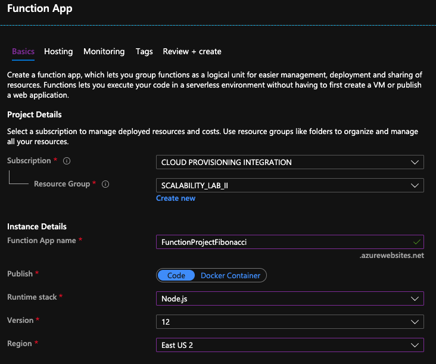

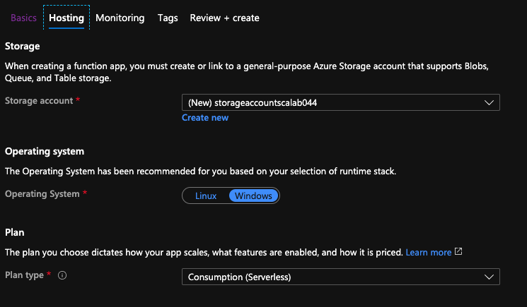

### Solución

La Function App se creó desde el portal de Azure con la siguiente configuración. El asistente del portal cambió respecto a las imágenes del enunciado (la pestaña *Hosting* ahora se llama **Storage**, y Node.js 12 ya no está disponible), así que se usó la versión actual.

| Campo | Valor usado |
|---|---|
| Suscripción | Azure for Students |
| Grupo de recursos | `SCALABILITY_LAB_II` (nuevo) |
| Publicación | Código |
| Pila de runtime | Node.js |
| Versión | 24 LTS |
| Región | Chile Central |
| Sistema operativo | Windows |
| Plan de hospedaje | Consumo (Windows), SKU *Dynamic* |
| Cuenta de Storage | nueva (`scalabilitylabiibc9c`) con conexión de Azure Files |
| Application Insights | Habilitado |

> El portal recomienda ahora *Consumo flexible* (Flex Consumption) como plan serverless de Azure Functions; se usó **Consumo** porque es el que pide el laboratorio.

**Datos básicos (suscripción, grupo de recursos y nombre):**

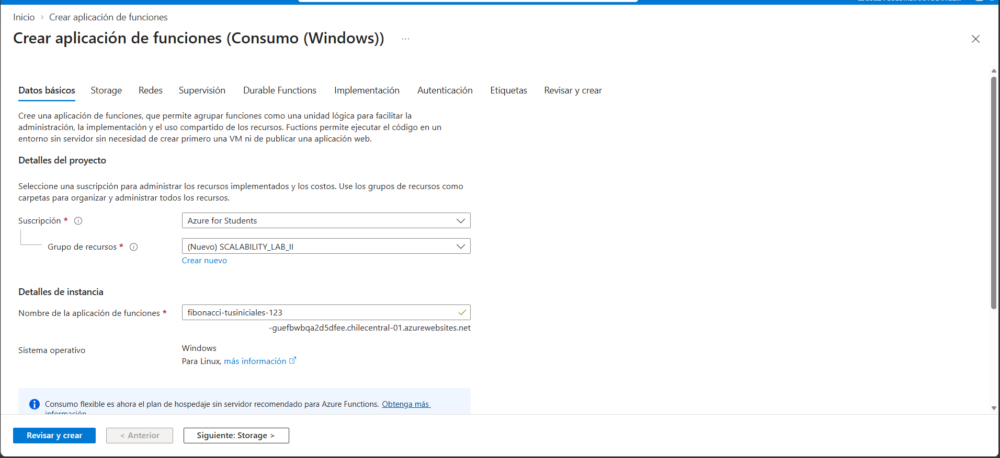

**Runtime (Node.js 24 LTS) y región (Chile Central):**

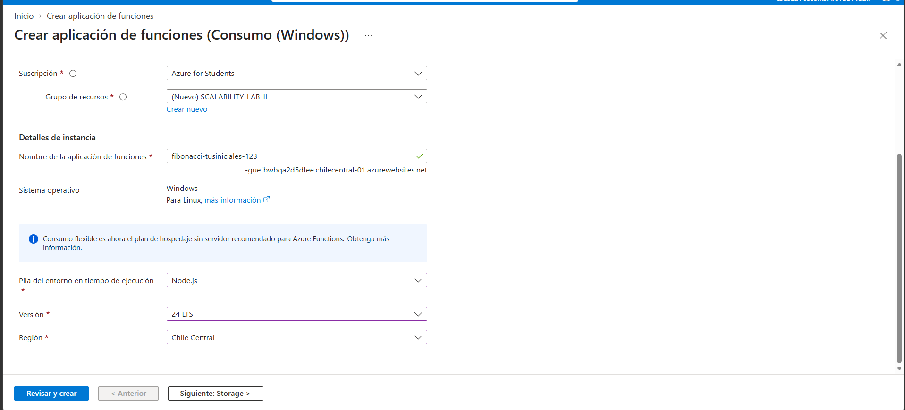

**Storage (cuenta de almacenamiento nueva):**

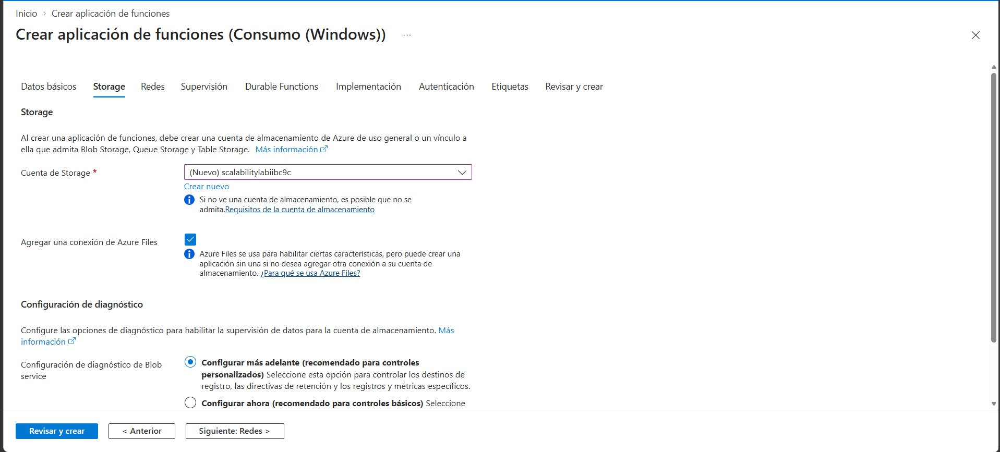

**Revisión final (plan Consumo Windows, SKU Dynamic, Application Insights):**

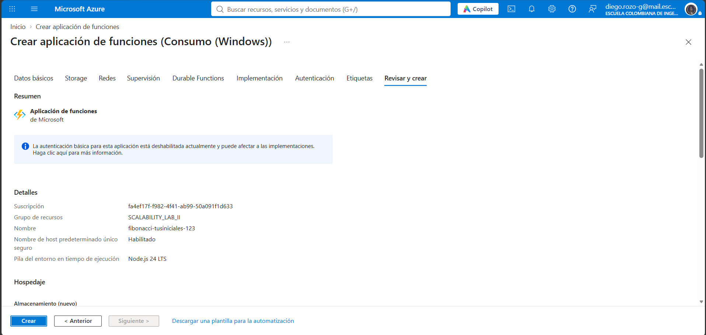

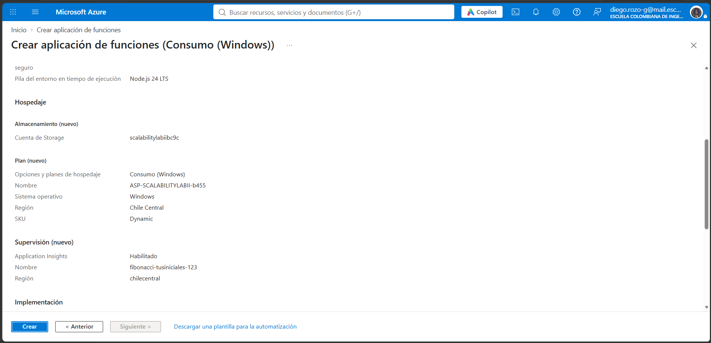

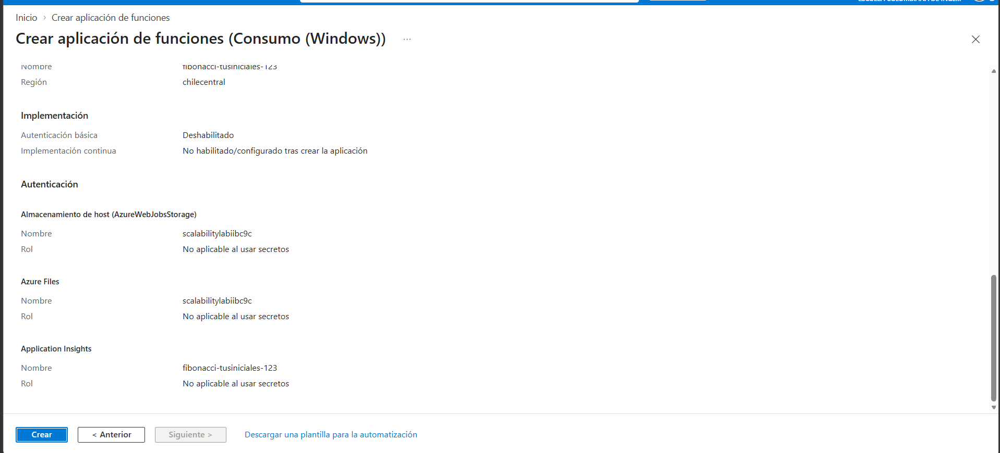

**Implementación completada y Function App en ejecución:**

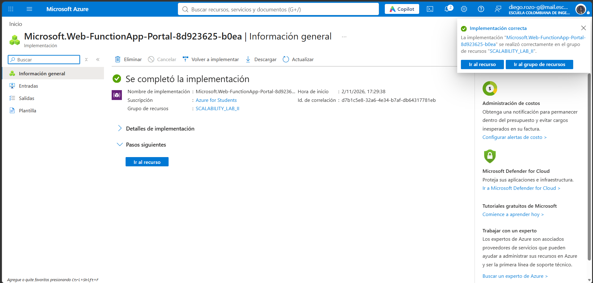

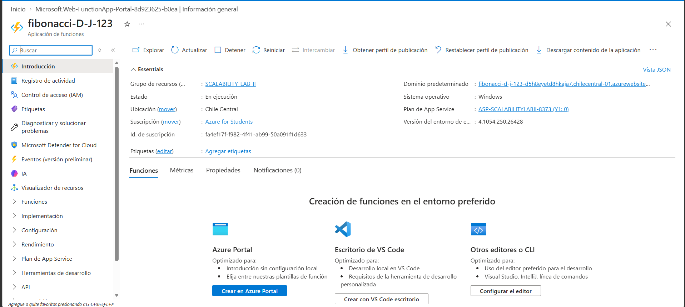

---

## 2. Instale la extensión de **Azure Functions** para Visual Studio Code.

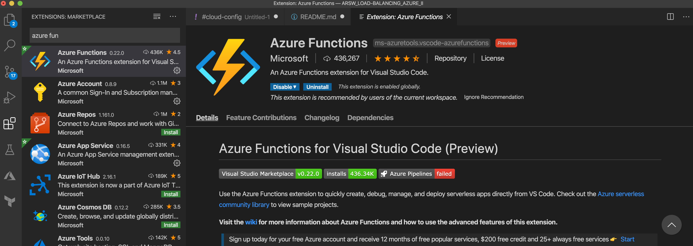

### Solución

Se instaló la extensión **Azure Functions** (Microsoft) en VS Code, junto con **Azure Functions Core Tools v4** (`func --version` → `4.16.0`) y **Node.js LTS**. Con la extensión instalada se inició sesión con la cuenta institucional desde el panel de Azure y aparece la suscripción *Azure for Students* con la Function App dentro de *Function App*.

Herramientas instaladas en Windows:

```powershell
node -v
npm install -g newman
npm install -g azure-functions-core-tools@4 --unsafe-perm true
func --version
```

---

## 3. Despliegue la Function de Fibonacci a Azure usando Visual Studio Code.

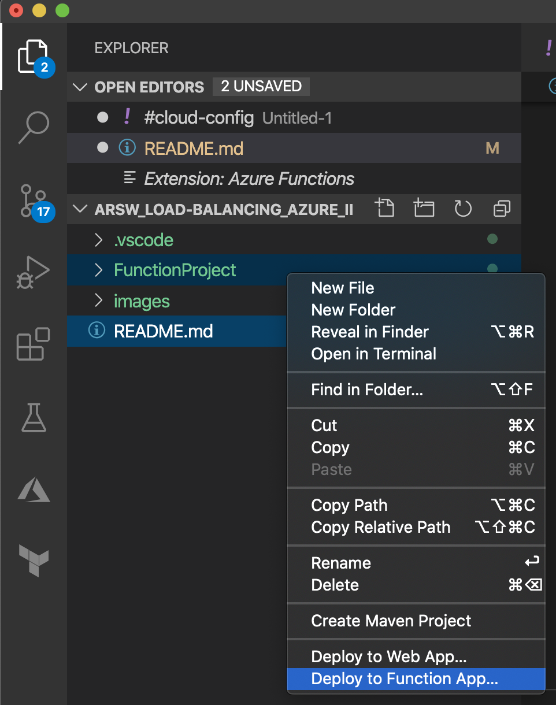

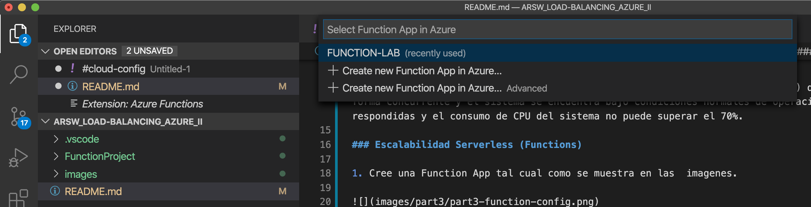

### Solución

Desde el panel de Azure de VS Code: clic derecho en la Function App → **Deploy to Function App...** → carpeta `FunctionProject`.

**Problema encontrado en el primer despliegue.** El código subió (`Deployment successful`), pero falló la sincronización de triggers con `ServiceUnavailable`. El portal mostró este error en la Function App:

```
Microsoft.Azure.WebJobs.Script: Error building configuration in an external startup class.
Referenced bundle Microsoft.Azure.Functions.ExtensionBundle of version 1.8.1 does not meet the
required minimum version of 2.6.1. Update your extension bundle reference in host.json to reference 2.6.1 or later.
```

**Causa:** el `host.json` del proyecto usaba el *extension bundle* `[1.*, 2.0.0)`, que el runtime actual ya no acepta.

**Solución:** actualizar el `host.json` al bundle 4.x y volver a desplegar.

```json
{
  "version": "2.0",
  "extensionBundle": {
    "id": "Microsoft.Azure.Functions.ExtensionBundle",
    "version": "[4.*, 5.0.0)"
  }
}
```

Con ese cambio el despliegue terminó correctamente, se sincronizaron los triggers y VS Code mostró las URLs HTTP:

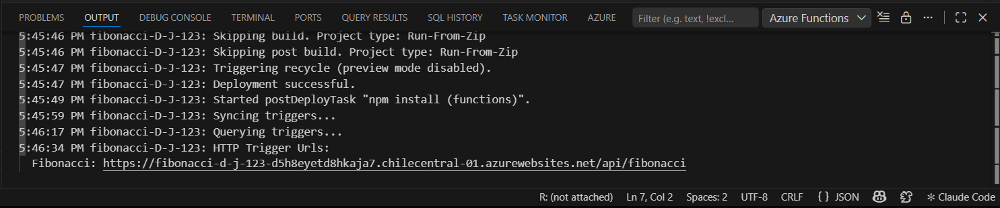

---

## 4. Dirijase al portal de Azure y pruebe la function.

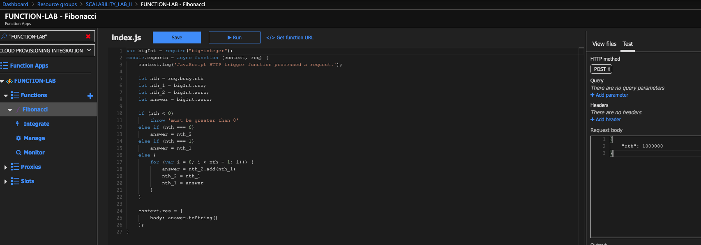

### Solución

**Prueba rápida desde PowerShell** con `nth = 100` (resultado correcto: `354224848179261915075`):

```powershell
Invoke-RestMethod -Method Post -Uri "https://fibonacci-d-j-123-d5h8eyetd8hkaja7.chilecentral-01.azurewebsites.net/api/fibonacci" -ContentType "application/json" -Body '{"nth": 100}'
```

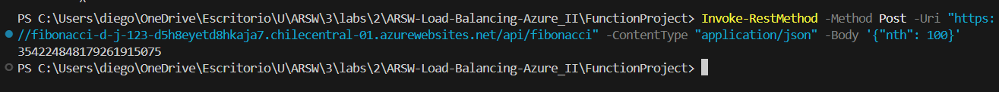

**Prueba desde el portal** (*Fibonacci → Código y prueba → Prueba/ejecución*), método **POST** y cuerpo `{ "nth": 1000000 }`:

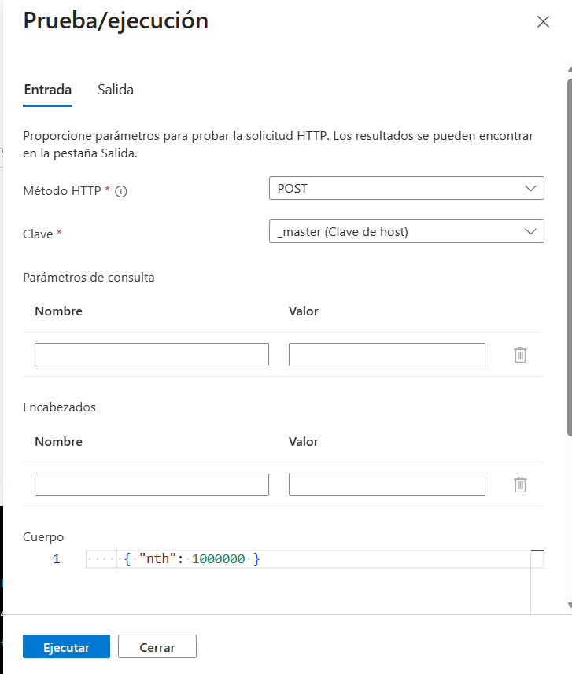

Resultado: **HTTP 200** con el número de Fibonacci de 1.000.000 (≈ 209.000 dígitos).

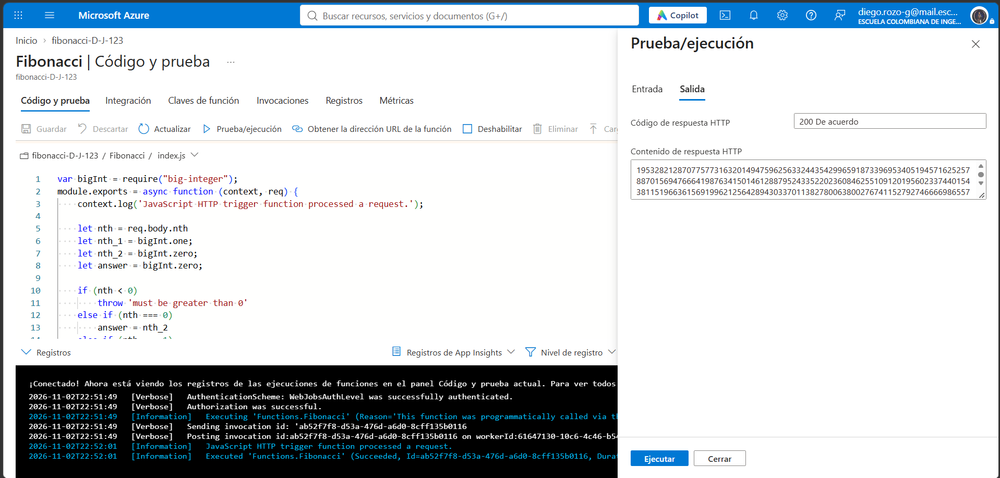

Los logs de la ejecución muestran `Executed 'Functions.Fibonacci' (Succeeded ... Duration=12157ms)`, es decir, **≈ 12,2 s** para una sola petición desde el portal:

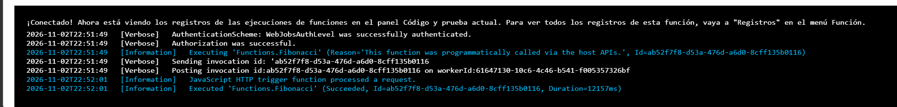

---

## 5. Modifique la coleción de POSTMAN con NEWMAN de tal forma que pueda enviar 10 peticiones concurrentes. Verifique los resultados y presente un informe.

### Solución

El proyecto no incluía la colección de Postman, así que se creó una (`newman/fibonacci.postman_collection.json`) con una petición `POST` con `nth = 1000000` y dos pruebas: código `200` y respuesta en menos de 60 s.

```json
{
  "info": {
    "name": "Fibonacci",
    "schema": "https://schema.getpostman.com/json/collection/v2.1.0/collection.json"
  },
  "item": [{
    "name": "Fib 1000000",
    "event": [{
      "listen": "test",
      "script": { "type": "text/javascript", "exec": [
        "pm.test('Status 200', function () { pm.response.to.have.status(200); });",
        "pm.test('Responde en menos de 60s', function () { pm.expect(pm.response.responseTime).to.be.below(60000); });"
      ]}
    }],
    "request": {
      "method": "POST",
      "header": [{ "key": "Content-Type", "value": "application/json" }],
      "body": { "mode": "raw", "raw": "{ \"nth\": 1000000 }" },
      "url": "https://fibonacci-d-j-123-d5h8eyetd8hkaja7.chilecentral-01.azurewebsites.net/api/fibonacci"
    }
  }]
}
```

**Ejecución de una sola petición (línea base):** 200 OK, 209,23 kB, **9,4 s**.

```powershell
newman run fibonacci.postman_collection.json
```

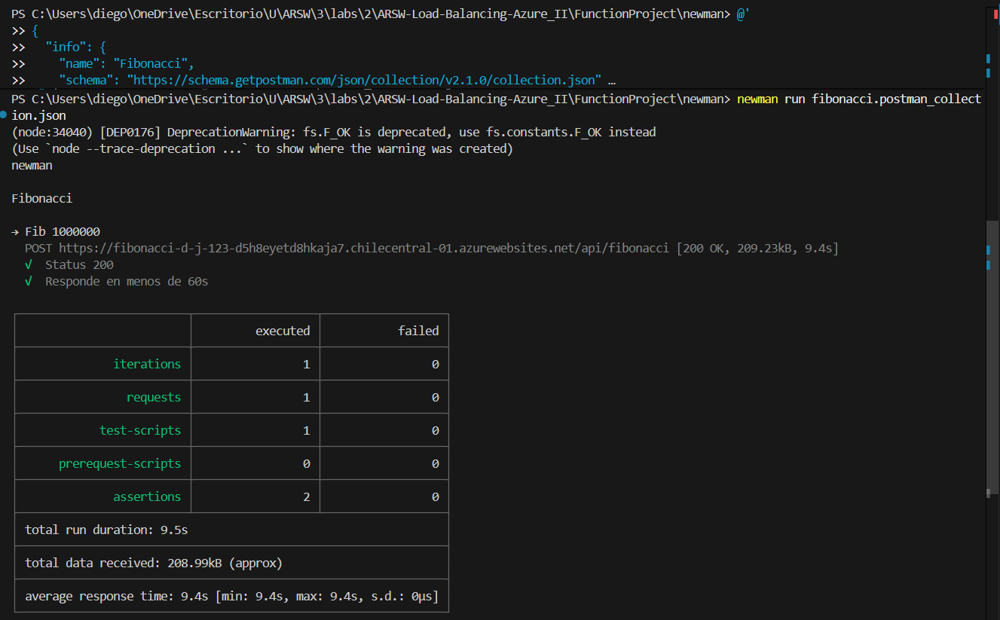

**Ejecución concurrente.** Newman ejecuta una petición a la vez, así que la concurrencia se logra lanzando **10 procesos de Newman en paralelo** con trabajos de PowerShell:

```powershell
$dir = (Get-Location).Path
$total = Measure-Command {
  $jobs = 1..10 | ForEach-Object {
    Start-Job -ArgumentList $_, $dir -ScriptBlock {
      param($i, $dir)
      $env:NODE_NO_WARNINGS = "1"
      Set-Location $dir
      newman run fibonacci.postman_collection.json --timeout-request 120000 -r "cli,json" --reporter-json-export "result_$i.json"
    }
  }
  $jobs | Wait-Job | Out-Null
}
$jobs | Receive-Job
"Tiempo total: $($total.TotalSeconds) s"
```

> Nota: el reporter debe ir entre comillas (`-r "cli,json"`). Sin ellas, PowerShell interpreta `cli,json` como una lista y Newman falla con `could not find "cli json" reporter`.

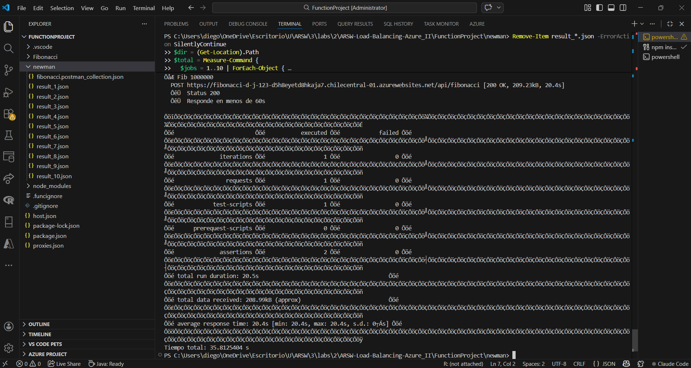

### Resultados

| # | Código | Tiempo de respuesta |
|---|---|---|
| 1 | 200 | 9,8 s |
| 2 | 200 | 9,6 s |
| 3 | 200 | 7,6 s |
| 4 | 200 | 17,3 s |
| 5 | 200 | 20,5 s |
| 6 | 200 | 8,4 s |
| 7 | 200 | 7,6 s |
| 8 | 200 | 9,5 s |
| 9 | 200 | 17,2 s |
| 10 | 200 | 20,4 s |

| Métrica | Valor |
|---|---|
| Peticiones exitosas | 10 / 10 (0 fallidas, 20/20 aserciones correctas) |
| Mínimo / Máximo / Promedio | 7,6 s / 20,5 s / 12,8 s |
| Línea base (1 petición) | 9,4 s |
| Tiempo total de la tanda | 35,8 s (incluye el arranque de los 10 procesos de Newman) |

**Application Insights** (últimos 30 minutos) registró el pico de ≈ 10 solicitudes simultáneas, **0 solicitudes con errores** y un tiempo de respuesta del servidor que subió hasta ≈ 30 s (promedio 18,08 s):

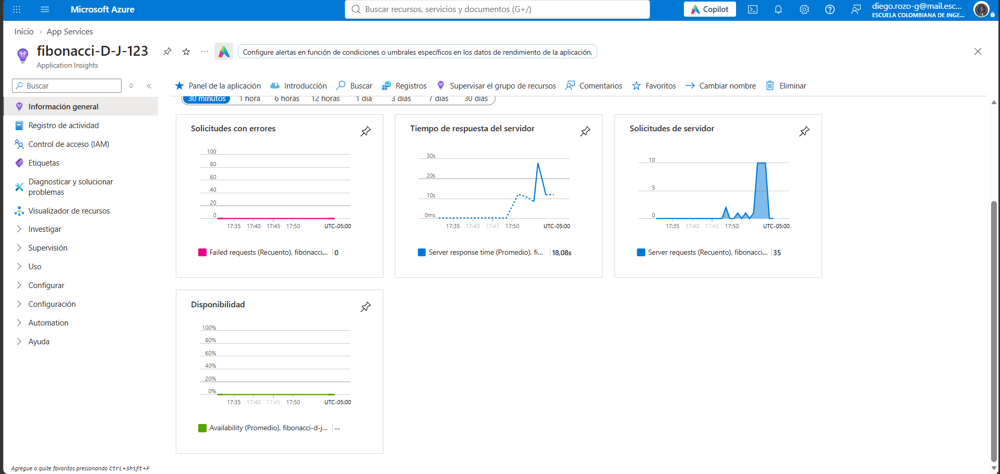

### Análisis

* **Todas las peticiones fueron respondidas** (10/10 con HTTP 200), por lo que esa parte del escenario de calidad se cumple.
* **La latencia se degrada bajo concurrencia.** Seis peticiones tardaron entre 7,6 y 9,8 s (similar a la línea base de 9,4 s) y cuatro tardaron entre 17,2 y 20,5 s, casi el doble.
* **Hipótesis (no verificada):** el cálculo es un ciclo intensivo en CPU que bloquea el hilo único de Node.js. Cuando dos peticiones llegan a la misma instancia, la segunda espera a que termine la primera (≈ 2 × 9 s ≈ 18 s). Las que cayeron en instancias distintas, que el plan Consumo fue añadiendo, no esperaron. El escalado automático del plan Consumo no es instantáneo.
* **CPU:** en esta prueba **no se midió** el consumo de CPU de las instancias, así que el requisito de "no superar el 70 %" no queda demostrado. Para evidenciarlo habría que repetir la prueba con *Live Metrics* de Application Insights abierto.

---

## 6. Cree una nueva Function que resuleva el problema de Fibonacci pero esta vez utilice un enfoque recursivo con memoization. Pruebe la función varias veces, después no haga nada por al menos 5 minutos. Pruebe la función de nuevo con los valores anteriores. ¿Cuál es el comportamiento?.

### Solución

Se creó la función **`Fibonacci2`** copiando la carpeta `Fibonacci` (mismo `function.json`) y reemplazando `index.js` por una versión recursiva con una caché en memoria (`memo`). Además de calcular, devuelve información de diagnóstico: si el valor ya estaba en caché (`cached`), el tamaño de la caché (`cacheSize`), el tiempo de vida del proceso (`uptimeSeconds`) y un identificador de la instancia (`instance`).

```js
var bigInt = require("big-integer");

// Cache en memoria: vive solo mientras esta instancia siga en ejecucion
const memo = { 0: bigInt.zero, 1: bigInt.one };

function fib(n) {
    if (memo[n] !== undefined) return memo[n];
    memo[n] = fib(n - 1).add(fib(n - 2));
    return memo[n];
}

module.exports = async function (context, req) {
    const nth = req.body.nth;
    if (nth < 0) throw "must be greater than 0";

    const cached = memo[nth] !== undefined;
    const t0 = Date.now();
    const answer = fib(nth).toString();

    context.res = {
        body: {
            nth: nth,
            cached: cached,
            ms: Date.now() - t0,
            cacheSize: Object.keys(memo).length,
            uptimeSeconds: Math.round(process.uptime()),
            instance: (process.env.WEBSITE_INSTANCE_ID || "local").slice(0, 8),
            digits: answer.length,
            value: answer.slice(0, 20) + "..."
        }
    };
};
```

Se desplegó de nuevo y VS Code mostró las dos URLs (`/api/fibonacci` y `/api/fibonacci2`). Se usaron valores pequeños (1000, 3000 y 5000) porque la recursión tiene un límite de profundidad de pila (unos 10.000 niveles en Node.js), por lo que con `nth = 1000000` esta versión no es viable.

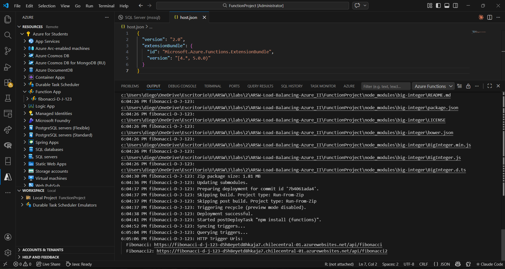

Script de prueba:

```powershell
$u = "https://fibonacci-d-j-123-d5h8eyetd8hkaja7.chilecentral-01.azurewebsites.net/api/fibonacci2"
foreach ($n in 1000, 3000, 5000, 1000, 3000, 5000) {
  Invoke-RestMethod -Method Post -Uri $u -ContentType "application/json" -Body "{`"nth`": $n}" | Format-List nth, cached, ms, cacheSize, uptimeSeconds, instance
}
```

### Prueba 1: llamadas consecutivas (18:06)

| nth | cached | ms | cacheSize | uptimeSeconds | instance |
|---|---|---|---|---|---|
| 1000 | False | 1 | 1001 | 4 | `8c41ae17` |
| 3000 | False | 1 | 3001 | 5 | `8c41ae17` |
| 5000 | False | 4 | 5001 | 51 | `1dbeebad` |
| 1000 | True | 0 | 5001 | 52 | `1dbeebad` |
| 3000 | True | 0 | 5001 | 52 | `1dbeebad` |
| 5000 | True | 0 | 5001 | 52 | `1dbeebad` |

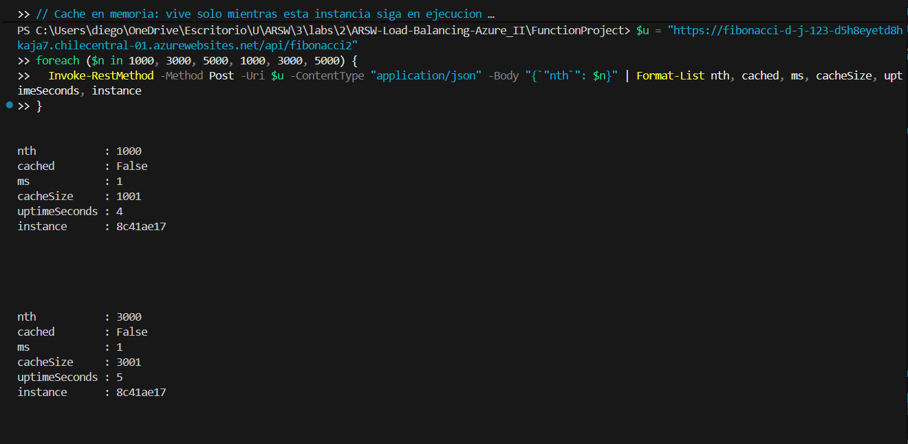

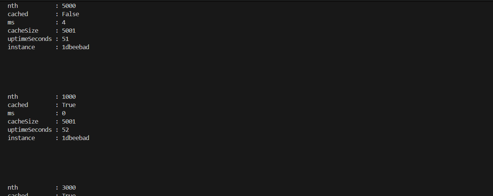

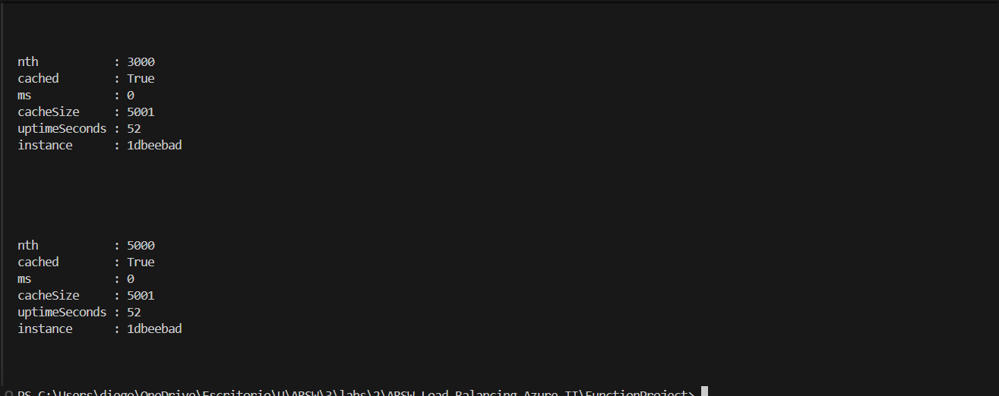

**Observación:** la petición con `nth = 5000` la atendió **otra instancia** (`1dbeebad`), cuya caché estaba vacía, por lo que se recalculó (`cached: False`). Después esa instancia ya tenía la caché llena hasta 5000 y respondió `True` a los tres valores.

### Prueba 2: después de ≈ 8 minutos sin tráfico (18:14)

| nth | cached | ms | cacheSize | uptimeSeconds | instance |
|---|---|---|---|---|---|
| 1000 | True | 0 | 3001 | 491 | `8c41ae17` |
| 3000 | True | 0 | 3001 | 491 | `8c41ae17` |
| 5000 | False | 1 | 5001 | 491 | `8c41ae17` |

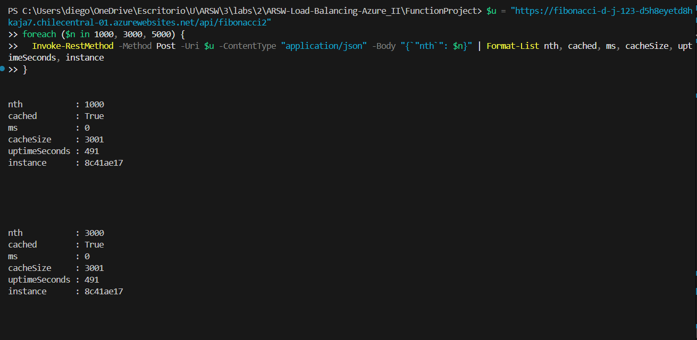

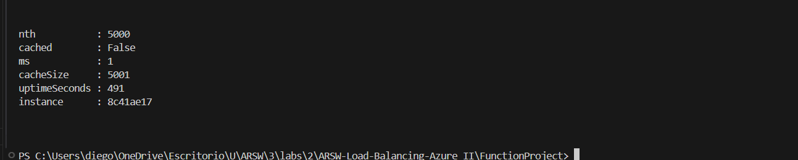

**Observación:** tras ≈ 8 minutos la instancia `8c41ae17` seguía viva (491 s de uptime) y conservaba su caché para 1000 y 3000. En cambio, el 5000 **no estaba en su caché**, porque ese valor lo había calculado antes la otra instancia: las cachés **no se comparten** entre instancias.

### Prueba 3: después de ≈ 29 minutos sin tráfico (18:35)

| nth | cached | ms | cacheSize | uptimeSeconds | instance |
|---|---|---|---|---|---|
| 1000 | False | 1 | 1001 | 3 | `8c41ae17` |
| 3000 | False | 0 | 3001 | 4 | `8c41ae17` |
| 5000 | False | 0 | 5001 | 4 | `8c41ae17` |

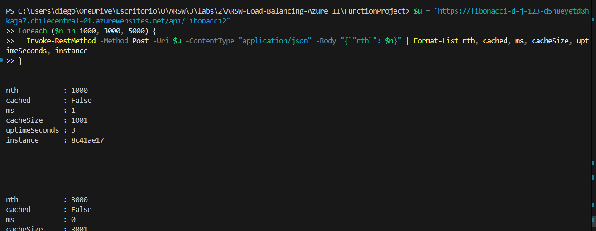

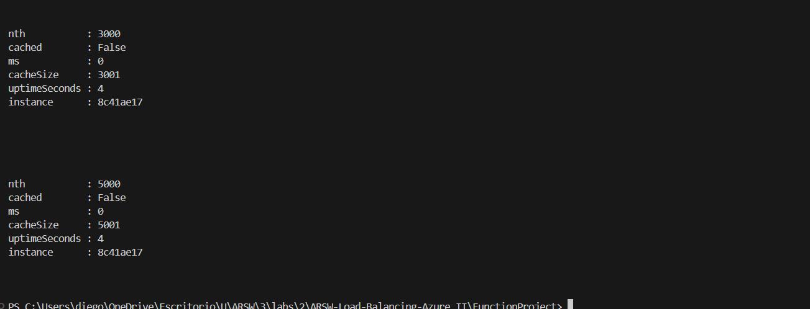

**Observación:** después de ≈ 29 minutos sin tráfico, **las tres respuestas fueron `cached: False`**, `cacheSize` volvió a empezar desde cero (1001, 3001, 5001) y `uptimeSeconds` se reinició (3-4 s). El proceso de la función se reinició y **perdió toda la caché**. El identificador `instance` es el del servidor y se conservó; lo que se perdió fue el proceso de Node.js con su memoria.

### ¿Cuál es el comportamiento?

1. Mientras la instancia sigue activa, la memoization funciona (`cached: True`, tiempo ≈ 0 ms).
2. La caché **no se comparte** entre instancias: un mismo valor puede resultar cacheado o no según qué instancia atienda la petición.
3. Tras un periodo de inactividad (≈ 29 min en esta prueba; con ≈ 8 min la instancia aún seguía viva), el proceso se recicla y **la caché se pierde por completo**.
4. Con valores pequeños el tiempo de cálculo es de milisegundos, así que la diferencia visible entre cacheado y no cacheado es el indicador `cached`, no el tiempo.

---

## Preguntas

### ¿Qué es un Azure Function?

Es el servicio de cómputo **serverless y orientado a eventos** de Azure. Permite ejecutar fragmentos de código (funciones) en respuesta a un **trigger** (una petición HTTP, un mensaje en una cola, un temporizador, un cambio en un blob, etc.) sin administrar servidores. Las funciones pueden recibir y enviar datos mediante **bindings** declarativos y se agrupan en una **Function App**, que es la unidad de despliegue, configuración y escalado. En este laboratorio la función `Fibonacci` usa un trigger HTTP (`httpTrigger`) y recibe `nth` en el cuerpo de la petición.

### ¿Qué es serverless?

Es un modelo de ejecución en la nube en el que el proveedor se encarga de aprovisionar, parchear y escalar la infraestructura, y el desarrollador solo entrega el código. Sus características son: **escalado automático** según la demanda (incluso a cero), **pago por uso** (no por servidor encendido) y **abstracción de la infraestructura**. Esto no significa que no haya servidores, sino que no se administran. Como contrapartida, hay **cold starts**, límites de tiempo y de memoria, y el código debe ser **sin estado** (como se vio con la caché de la memoization).

### ¿Qué es el runtime y que implica seleccionarlo al momento de crear el Function App?

El *runtime stack* es el lenguaje y la versión en la que se ejecuta el código de las funciones (aquí **Node.js 24 LTS**), sobre el *host* de Azure Functions (versión 4). Al seleccionarlo se define:

* el **lenguaje y la versión** soportados por la app (todas las funciones de la Function App usan el mismo runtime);
* el **modelo de programación** y las dependencias compatibles (aquí el modelo clásico con `function.json`);
* las **opciones disponibles** de sistema operativo, plan y herramientas locales de desarrollo.

Una versión antigua o fuera de soporte provoca problemas. En el laboratorio ya no existía Node.js 12 y, además, el `host.json` con el *extension bundle* 1.x fue rechazado por el host (`Referenced bundle ... version 1.8.1 does not meet the required minimum version of 2.6.1`), por lo que hubo que actualizarlo a `[4.*, 5.0.0)`.

### ¿Por qué es necesario crear un Storage Account de la mano de un Function App?

Porque el runtime de Azure Functions usa una cuenta de almacenamiento de uso general (con Blob, Queue y Table) para su funcionamiento interno (conexión `AzureWebJobsStorage`):

* guardar las **claves de acceso** y los secretos de las funciones;
* gestionar los **triggers** (por ejemplo, colas y *leases* de blobs) y coordinar el **escalado** entre instancias;
* almacenar **registros y metadatos** de ejecución;
* en el plan Consumo, **Azure Files** guarda el contenido de la aplicación (el código y la configuración compartida entre instancias).

Por eso el asistente exige crear o enlazar una cuenta de almacenamiento. En esta práctica se creó `scalabilitylabiibc9c`, con la conexión de Azure Files activada.

### ¿Cuáles son los tipos de planes para un Function App?, ¿En qué se diferencias?, mencione ventajas y desventajas de cada uno de ellos.

| Plan | Escalado y modelo de cobro | Ventajas | Desventajas |
|---|---|---|---|
| **Consumo** (Consumption) | Escala automáticamente y hasta cero; se paga por ejecuciones y por GB-segundo | Costo mínimo en cargas bajas o esporádicas; capa gratuita mensual; sin administración | *Cold start*; tiempo máximo por ejecución limitado (5 min por defecto, máx. 10); memoria y CPU limitadas por instancia; opciones de red limitadas; es el plan más antiguo, y el portal ya recomienda Flex Consumption |
| **Consumo flexible** (Flex Consumption) | Escala por función hasta cero; se paga por uso, con instancias "siempre listas" opcionales | Escalado más rápido y granular; *cold start* reducible; integración con redes virtuales; tamaño de instancia configurable; es el plan serverless recomendado actualmente | Es más nuevo y no todas las regiones o características están disponibles; la configuración es más amplia |
| **Premium** (Elastic Premium) | Escala automáticamente con instancias *pre-warmed* (siempre al menos una instancia); se paga por vCPU y memoria asignadas | Sin *cold start*; mayor CPU y memoria; integración con redes virtuales; ejecuciones largas | Más costoso: siempre se paga al menos una instancia, aunque no haya tráfico |
| **Dedicado** (App Service Plan) | Corre sobre las máquinas de un App Service Plan, con escalado manual o por reglas; costo fijo del plan | Costo predecible; ideal si ya hay un plan con capacidad ociosa; "Always On"; sin límite de duración | No escala a cero; el escalado es más lento y hay que configurarlo; se paga el plan aunque no se use |

> También existe el hospedaje en **Azure Container Apps** (funciones en contenedores), con escalado orientado a eventos y más control del entorno. Para este laboratorio se usó **Consumo (Windows)**.

### ¿Por qué la memoization falla o no funciona de forma correcta?

Con base en lo observado en las pruebas de este laboratorio:

1. **La caché vive en la memoria del proceso.** Se pierde cuando la instancia se recicla por inactividad, se reinicia, se actualiza el código o la plataforma la mueve. En la prueba, tras ≈ 29 min sin tráfico, todo pasó a `cached: False` y `cacheSize` empezó otra vez desde cero.
2. **La caché no se comparte entre instancias.** Al escalar, cada instancia tiene su propia memoria. En la prueba, el valor 5000 lo atendió otra instancia (`1dbeebad`) y no estaba en la caché de la primera (`8c41ae17`).
3. **Las funciones serverless deben ser sin estado**, porque la plataforma no garantiza que dos peticiones consecutivas lleguen a la misma instancia ni que la instancia siga viva.
4. **La recursión tiene límites.** Para `n` muy grande (por ejemplo, 1.000.000) se desborda la pila de llamadas (≈ 10.000 niveles), por lo que el enfoque recursivo no es aplicable al escenario de calidad del laboratorio.

**Alternativa:** guardar la caché en un servicio externo y compartido, como **Azure Cache for Redis**, o en **Azure Table/Blob Storage** o una base de datos, y usar una versión iterativa del algoritmo.

### ¿Cómo funciona el sistema de facturación de las Function App?

Depende del plan:

* **Consumo:** se cobra por **número de ejecuciones** y por **consumo de recursos en GB-segundo** (memoria usada × tiempo de ejecución). El tiempo se mide en milisegundos (con un mínimo por ejecución) y la memoria se redondea a múltiplos de 128 MB. Hay una **concesión gratuita mensual** (1 millón de ejecuciones y 400.000 GB-s por suscripción). No se paga cuando la función no se ejecuta.
* **Consumo flexible:** se paga por el tiempo de ejecución y la memoria de las instancias, más un costo por las instancias "siempre listas" si se configuran.
* **Premium:** se paga por los **vCPU-segundo y GB-segundo** de las instancias asignadas, con al menos una instancia siempre activa.
* **Dedicado:** se paga el **App Service Plan** por tiempo, se ejecute o no la función.

En todos los casos se cobran aparte la **cuenta de almacenamiento**, **Application Insights** (por volumen de datos) y el tráfico de salida. 

*Estimación para este laboratorio:* las 10 peticiones concurrentes duraron entre 7,6 y 20,5 s (≈ 128 s de ejecución en total). Con una memoria de entre 128 MB y 1,5 GB, equivalen a unos 16 a 190 GB-s, muy por debajo de los 400.000 GB-s gratuitos del mes. Es una estimación, ya que no se midió la memoria real.

---

## Informe

### Resumen

Se desplegó la función `Fibonacci` en una Function App de Azure (plan Consumo, Node.js 24, Chile Central) desde Visual Studio Code, se probó desde el portal y por línea de comandos, y se sometió a 10 peticiones concurrentes con Newman. Además, se creó `Fibonacci2` con memoization para observar el comportamiento de una caché en memoria en un entorno serverless.

### Resultados principales

| Prueba | Resultado |
|---|---|
| Despliegue | Correcto, tras actualizar el *extension bundle* en `host.json` a `[4.*, 5.0.0)` |
| `Fibonacci` con `nth = 1000000` (1 petición) | HTTP 200, 9,4 s (Newman) y 12,2 s (portal) |
| 10 peticiones concurrentes | 10/10 con HTTP 200, 7,6 s a 20,5 s, promedio 12,8 s |
| Errores en Application Insights | 0 solicitudes con errores |
| CPU ≤ 70 % | No medido en esta prueba |
| `Fibonacci2` con la instancia activa | Caché funciona (`cached: True`, ≈ 0 ms) |
| `Fibonacci2` entre instancias | La caché no se comparte |
| `Fibonacci2` tras ≈ 29 min de inactividad | Caché perdida (`cached: False`, uptime reiniciado) |

### Conclusiones

1. El plan **Consumo** permite desplegar la función y atender la carga concurrente de la prueba sin errores, sin administrar servidores. Todas las peticiones fueron respondidas.
2. El escalado automático **no es instantáneo**: bajo 10 peticiones simultáneas, cuatro tardaron casi el doble que la línea base. Como el cálculo consume CPU en un solo hilo, la latencia depende de cuántas peticiones comparten instancia.
3. Para cumplir el escenario de calidad con cargas más pesadas conviene **optimizar el algoritmo** (por ejemplo, usando *fast doubling*), repartir el trabajo, o usar un plan con instancias dedicadas o *pre-warmed* (Premium o Flex Consumption con instancias siempre listas).
4. La **memoization en memoria no es una estrategia confiable en serverless**: se pierde con el reciclaje de la instancia y no se comparte entre instancias. Hay que usar un almacén externo (por ejemplo, Redis) si se quiere cachear.
5. **Lecciones del laboratorio:** el proyecto base tenía versiones obsoletas (Node.js 12 y *extension bundle* 1.x) que fue necesario actualizar; en PowerShell la concurrencia con Newman requiere lanzar varios procesos y entrecomillar los reporters.

### Limpieza

Al finalizar el laboratorio se recomienda **eliminar el grupo de recursos `SCALABILITY_LAB_II`** para no consumir el crédito de la suscripción de estudiante.
